# LangGraph execution-assurance lab

This is the advanced companion to `langgraph-governed-operations-intg`.
The foundational lab teaches runtime authorization. This independent lab uses
the same public AIGP OSS APIs to demonstrate the full supported banking
lifecycle:

```text
delegation → authorization → enforcement → execution receipt → recovery
→ replay eligibility → controlled replay → causal audit
```

It does not import, invoke, configure, or modify the foundational lab.

## What this lab owns—and what it does not

- AIGP OSS owns the authorization decision, tenant-scoped delegation store,
  append-only evidence, receipt validation, replay eligibility, and audit
  lineage.
- LangGraph and this lab own orchestration, the protected-tool enforcement
  point, private snapshots, isolation, external transaction correctness, and
  recovery.
- SQLite simulates an external banking application. AIGP never opens it,
  coordinates its transaction, retries its mutation, or proves it changed.
- A receipt is an authenticated runtime attestation. It is not independent
  proof that an external mutation occurred.

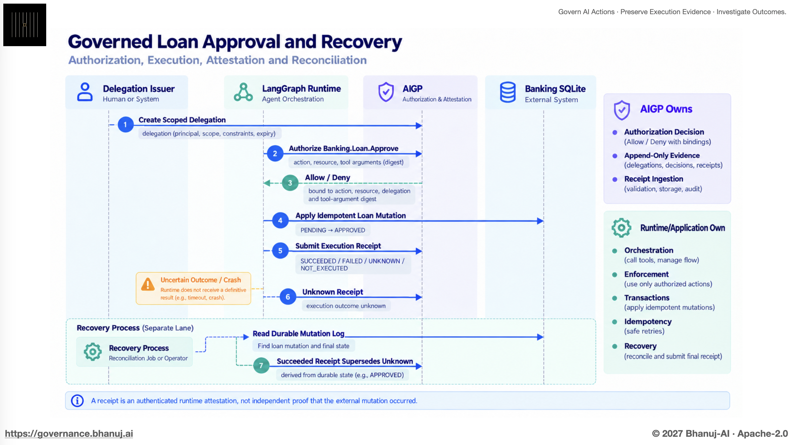

The diagram is conceptual. The terminal and Studio evidence shown below are
the observed results. In particular, an `UNKNOWN` receipt is not a retry
instruction: recovery first reads durable runtime/application state, then
submits a terminal receipt that supersedes the uncertain one.

## Architecture

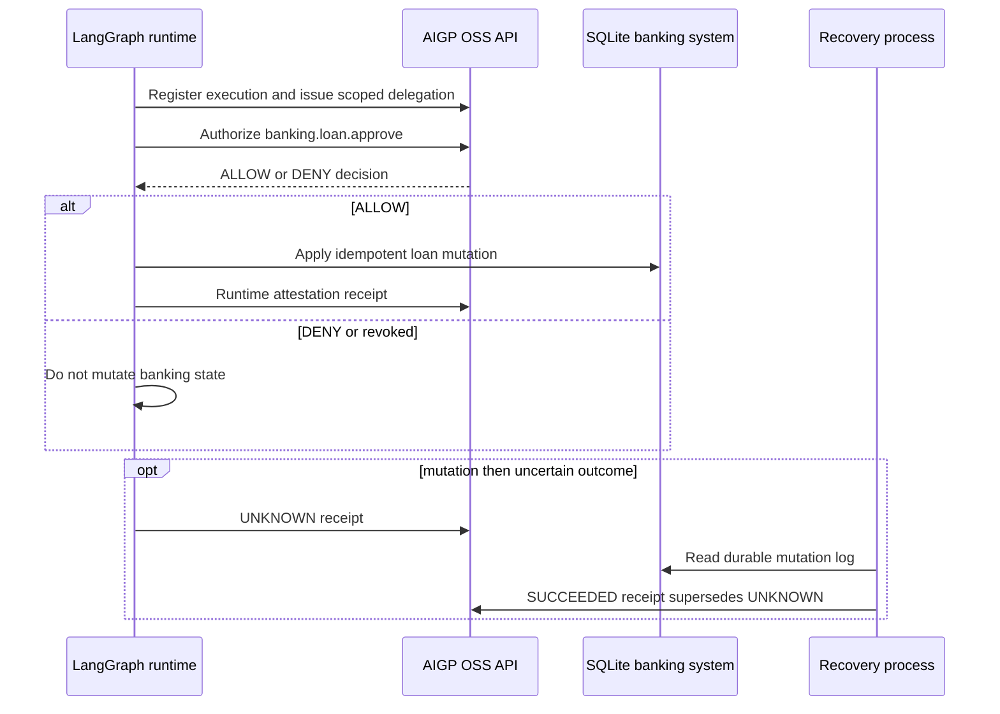

OSS owns the authorization decision and append-only evidence. LangGraph owns
orchestration and enforcement. SQLite is an external application owned by this
lab. A receipt authenticates the runtime's bounded claim; it is not AIGP proof
that SQLite changed. Recovery reads SQLite's idempotent mutation log and never
replays the original write.

For controlled replay, the direction and ownership remain deliberately
different:

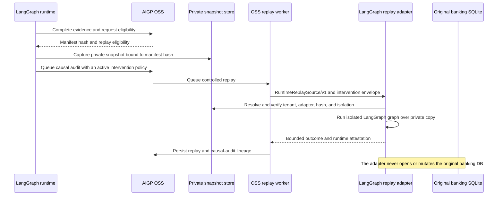

`RuntimeReplaySource/v1` carries only an opaque reference and bounded binding
claims. A manifest hash detects inconsistency between the governed manifest and
the runtime snapshot; it does not establish that the snapshot, receipt, or
external mutation is independently true.

## 1. Install lab and published LangGrpah Replay Adapter

Start a compatible AIGP OSS API and clone the labs repository:

```sh
cd labs/agent-frameworks/langgraph/langgraph-execution-assurance-lab
python -m venv .venv
. .venv/bin/activate
python -m pip install --no-cache-dir --upgrade -r requirements.txt

# requirements.txt installs the public v0.1.0 adapter release, not an editable checkout.
python -c "from importlib.metadata import version; assert version('aigp-langgraph-replay-adapter') == '0.1.0'"
export AIGP_LANGGRAPH_REPLAY_SNAPSHOT_DB=/tmp/aigp-langgraph-private-snapshots.db
```

The private snapshot database remains runtime-owned. Do not mount it into the
OSS API process unless that process is deliberately configured as the replay
worker. Adapter installation is an operational availability condition; it does
not change the historical replay eligibility of an execution.

## 2. Obtain the real actor IDs and short-lived tokens

Do not write placeholder identities such as `runtime-service` or
`delegation-service`, and do not use literal values such as `issuer-token`.
The local Keycloak stack generates service-account subject IDs. Resolve them
once the stack is running, then use the printed IDs consistently in Studio and
in this terminal.

From this lab directory, set the path to your OSS checkout and run:

```sh
export AIGP_LAB_ROOT="$PWD"
export AIGP_OSS_ROOT=/absolute/path/to/ai-governance-oss

cd "$AIGP_OSS_ROOT"
./scripts/keycloak/get-service-account-actorids.sh

set -a
source .env.oauth.generated
source .env.service-accounts.generated
source keycloak-postgres/.env.keycloak
set +a

# The walkthrough service account creates/revokes delegations.
export AIGP_ISSUER_ACTOR_ID="$AI_GOVERNANCE_WALKTHROUGH_ACTOR_ID"

# The local dedicated external-runtime subject runs the LangGraph lab. It has
# the least-privilege runtime, replay-eligibility, and causal-audit reads.
export AIGP_RUNTIME_ACTOR_ID="$AI_GOVERNANCE_SYNTHETIC_RUNTIME_ACTOR_ID"

export AIGP_BASE_URL=http://localhost:8000
export AIGP_ORGANIZATION_ID=org_default
export AIGP_PROJECT_ID=project_default

# Fresh, short-lived issuer token. Never print, paste, or commit it.
export AIGP_ISSUER_TOKEN="$(
  uv run python -c 'from ai_governance.oauth.client_credentials import access_token_from_environment; print(access_token_from_environment())'
)"

# Fresh, short-lived runtime token. It is intentionally a different identity.
export AIGP_RUNTIME_TOKEN="$(
  AI_GOVERNANCE_OAUTH_TOKEN_URL="$AI_GOVERNANCE_OAUTH_TOKEN_URL" \
  AI_GOVERNANCE_OAUTH_CLIENT_ID=synthetic-agent-runtime \
  AI_GOVERNANCE_OAUTH_CLIENT_SECRET="${SYNTHETIC_RUNTIME_CLIENT_SECRET:-local-synthetic-runtime-client-secret}" \
  uv run python -c 'from ai_governance.oauth.client_credentials import access_token_from_environment; print(access_token_from_environment())'
)"

printf 'Issuer:  %s\nRuntime: %s\n' "$AIGP_ISSUER_ACTOR_ID" "$AIGP_RUNTIME_ACTOR_ID"
cd "$AIGP_LAB_ROOT"
```

The two printed values are actor identifiers, not credentials. Copy those
values into the policy conditions below. If a live run reports `token_expired`,
repeat only the two token-generation exports before trying again.

## 3. Configure Policy 1: delegation issuance

This policy controls who may create a delegation. It does **not** allow the
banking mutation. Create and activate it before issuing any delegation.

Create a policy in Studio with:

| Field | Value |
| --- | --- |
| Name | `Lab: issue loan-approval delegation` |
| Category | `SECURITY` |
| Target scope | `Agent execution` |
| Effect | `APPROVE` |
| Priority | `10` |
| Severity | `HIGH` |
| Reason | `Allow the lab issuer to delegate this loan approval to the runtime.` |

Set the policy-definition metadata to:

```json
{
  "runtime_action_delegation_issuance": {
    "purpose": "runtime_action_delegation_issuance"
  }
}
```

Add these five `EQUALS` conditions:

| Field | Expected value | Why |
| --- | --- | --- |
| `issuer.id` | value printed as `Issuer` | The server-authenticated subject allowed to create a delegation. |
| `runtime_actor.id` | value printed as `Runtime` | The runtime receiving the delegation. |
| `action.id` | `banking.loan.approve` | The only action delegated in this lab. |
| `resource.type` | `sqlite.row` | The bounded external resource kind. |
| `resource.reference` | `loan:LOAN-001` | The one loan record that may be delegated. |

Do not use `actor.id` or `delegation.*` in this policy. No delegation exists
when it is evaluated; the issuance evidence has `issuer.id` and
`runtime_actor.id` instead.

| Create draft | Enter rules |
| --- | --- |
| 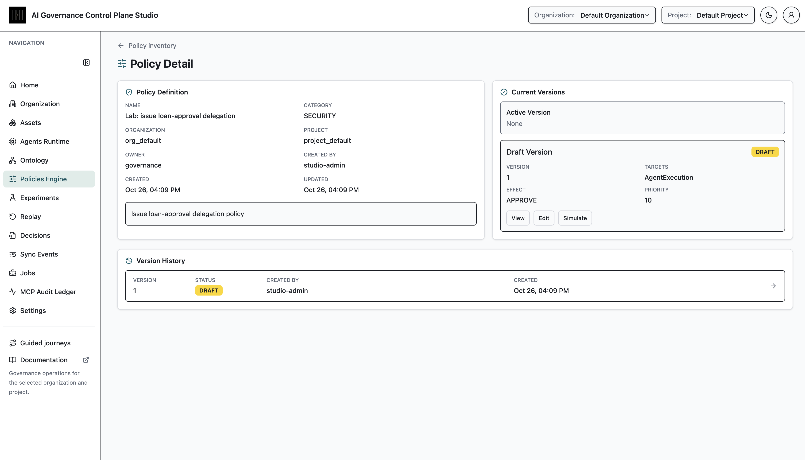 | 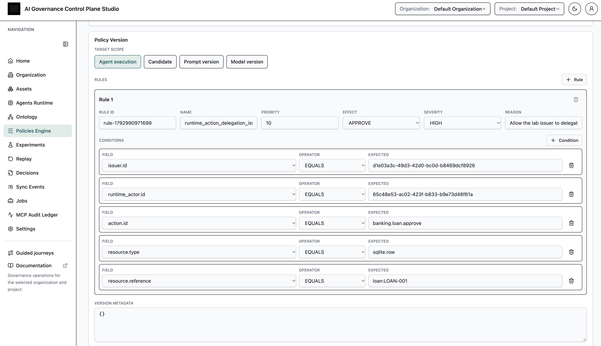 |

| Review scope | Activate Policy 1 |
| --- | --- |
| 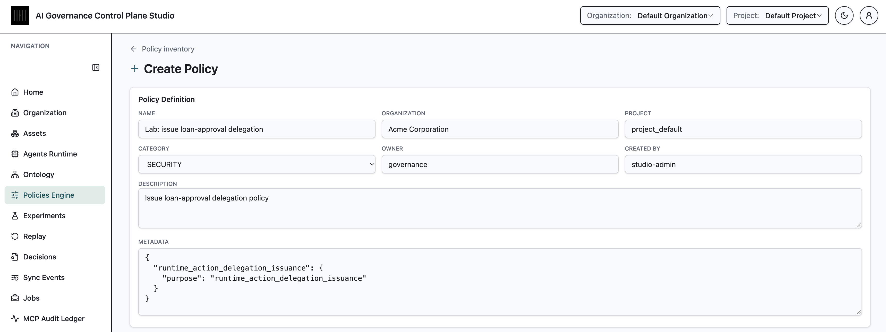 | 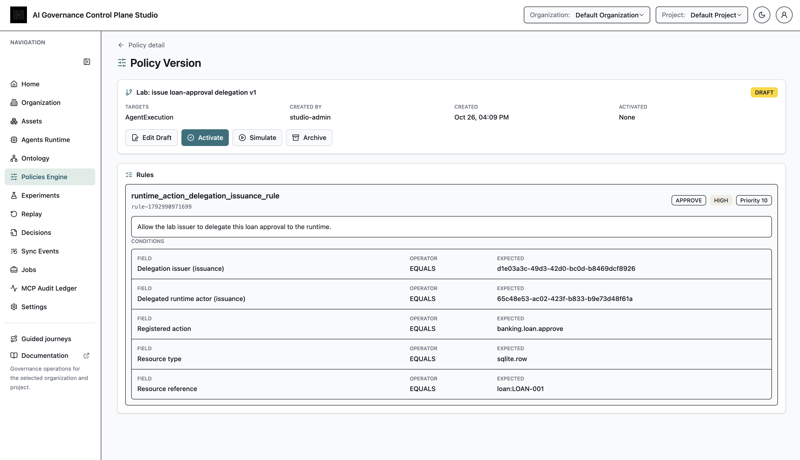 |

## 4. Configure Policy 2: runtime-action authorization

This policy controls whether the runtime may execute the proposed banking
mutation. The PDP resolves the saved delegation first, then evaluates this
policy against the authenticated runtime, action, and resource. A valid
delegation alone does not allow the mutation.

Create a second policy in Studio with:

| Field | Value |
| --- | --- |
| Name | `Lab: authorize loan approval` |
| Category | `SECURITY` |
| Target scope | `Agent execution` |
| Effect | `APPROVE` |
| Priority | `10` |
| Severity | `HIGH` |
| Reason | `Allow the delegated runtime to approve the specified loan.` |

Set the policy-definition metadata to:

```json
{
  "runtime_action_authorization": {
    "purpose": "runtime_action_authorization",
    "registered_actions": ["banking.loan.approve"],
    "registered_resource_types": ["sqlite.row"]
  }
}
```

Add these five `EQUALS` conditions:

| Field | Expected value | Why |
| --- | --- | --- |
| `actor.id` | value printed as `Runtime` | The authenticated runtime proposing the action. |
| `delegation.issuer_id` | value printed as `Issuer` | The issuer resolved from the stored delegation, not from a caller claim. |
| `action.id` | `banking.loan.approve` | The protected, registered action. |
| `resource.type` | `sqlite.row` | The bounded external resource kind. |
| `resource.reference` | `loan:LOAN-001` | The one loan record the policy can approve. |

Do not add `delegation.id`: a new delegation is created for every execution.
The PDP resolves its immutable ID, digest, expiry, revocation state, scope,
and issuer from the tenant-scoped store.

| Create Policy 2 | Enter rules |
| --- | --- |
| 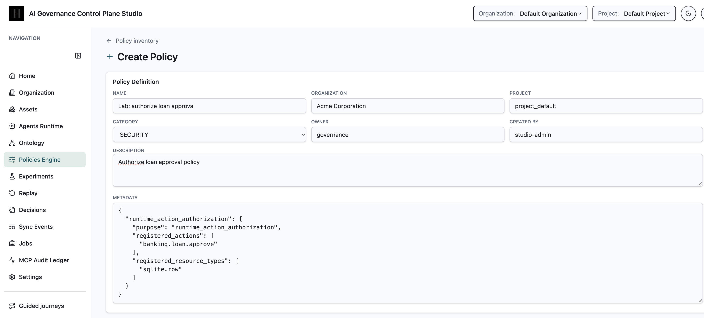 | 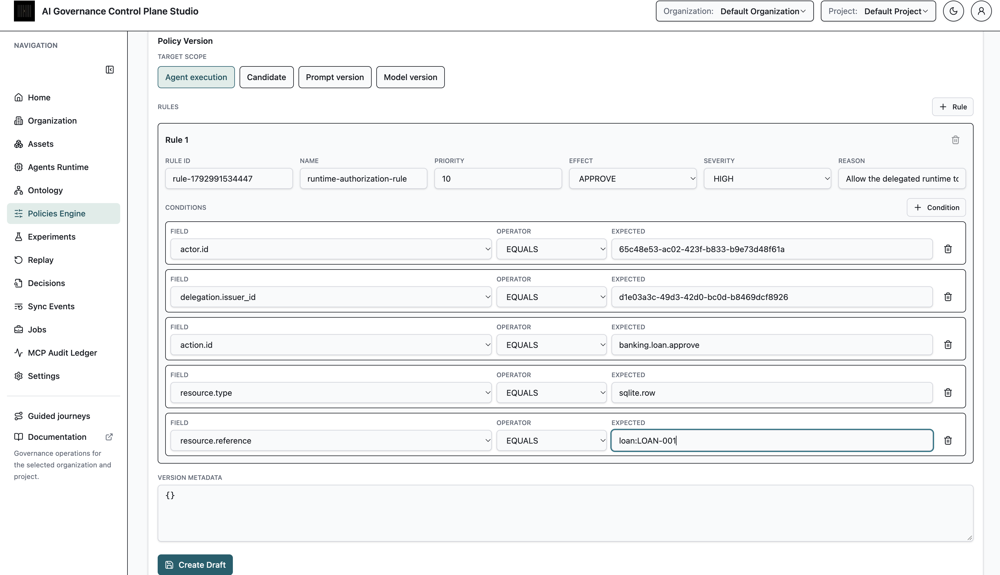 |

| Activate Policy 2 | Confirm both policies are active |
| --- | --- |
| 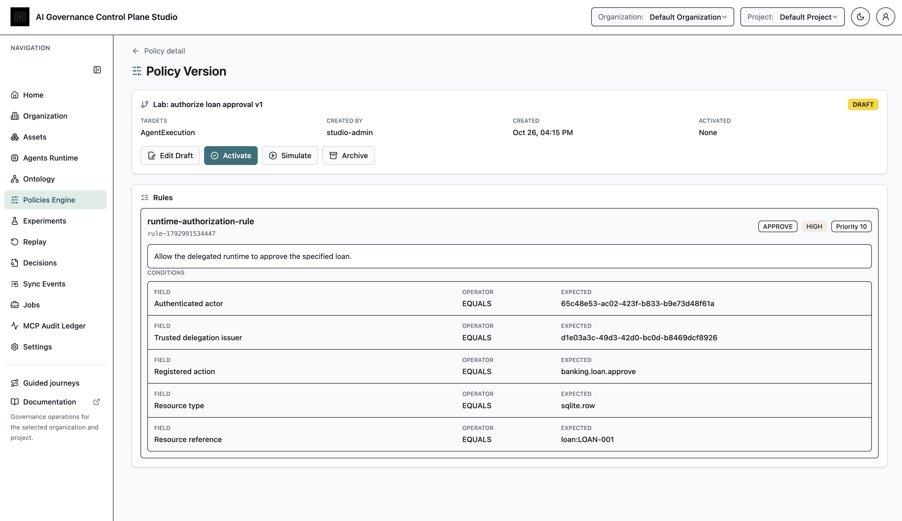 | 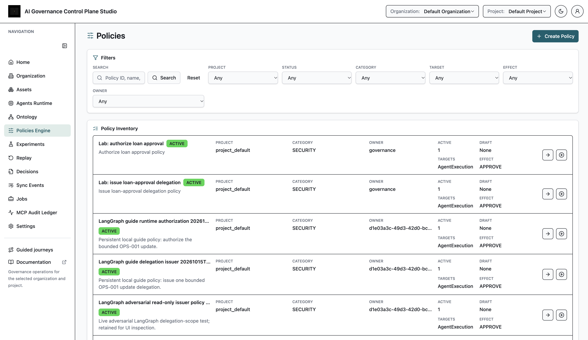 |

## 5. Run and Capture Scenarios

Every command prints an execution ID and correlation ID. `tee` saves bounded
evidence—IDs, statuses, reason codes, and digests—but never a bearer token.

```sh
mkdir -p evidence
set -o pipefail

python run_lab.py authorized \
  --database /tmp/aigp-banking.db \
  --snapshot-database /tmp/aigp-private-snapshots.db \
  | tee evidence/authorized.json

python run_lab.py unauthorized \
  --database /tmp/aigp-banking-denied.db \
  | tee evidence/unauthorized.json

python run_lab.py revoked \
  --database /tmp/aigp-banking-revoked.db \
  | tee evidence/revoked.json

# Run recovery only after crash writes this state file.
python run_lab.py crash \
  --database /tmp/aigp-banking-recovery.db \
  --state /tmp/aigp-recovery.json \
  | tee evidence/crash.json

python run_lab.py recover \
  --database /tmp/aigp-banking-recovery.db \
  --state /tmp/aigp-recovery.json \
  | tee evidence/recovery.json

python run_lab.py invalid-manifest \
  --database /tmp/aigp-banking-invalid.db \
  | tee evidence/invalid-manifest.json

PYTHONPATH=. python -m pytest -q | tee evidence/pytest.txt
```

## 6. Start Evidence Review

Open **Agents Runtime → Executions** in Studio first. It is the inventory:
find each scenario by the execution ID or correlation ID in its JSON file,
compare the outcomes, then open a single execution for the detailed timeline.

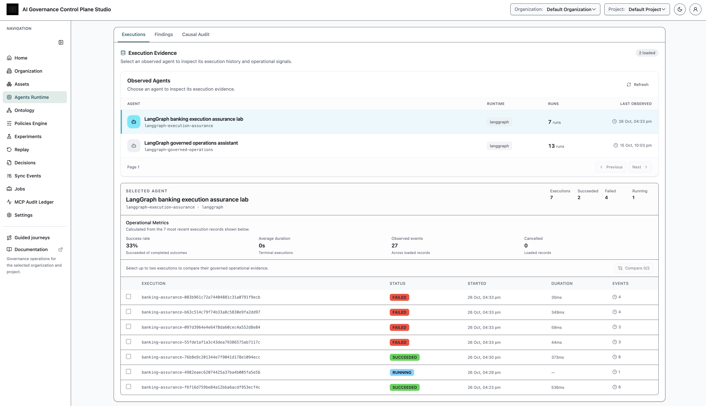

The evidence chain for an allowed run is authorization → tool evidence →
receipt → replay-manifest eligibility. AIGP stores this bounded evidence and
lineage; it does not own or reopen the banking database.

## 7. Observed Scenario Results

The following are identifier-redacted outputs captured from the local lab.
They are not invented fixture responses.

### Authorized operation: ALLOW, mutation, receipt, and manifest

The SQLite record changes only after `ALLOW_POLICY_MATCHED`. The output also
contains a replay-manifest hash. `INTERVENTION_POLICY_NOT_CONFIGURED` means
the execution evidence is present, but a causal audit cannot be queued yet.

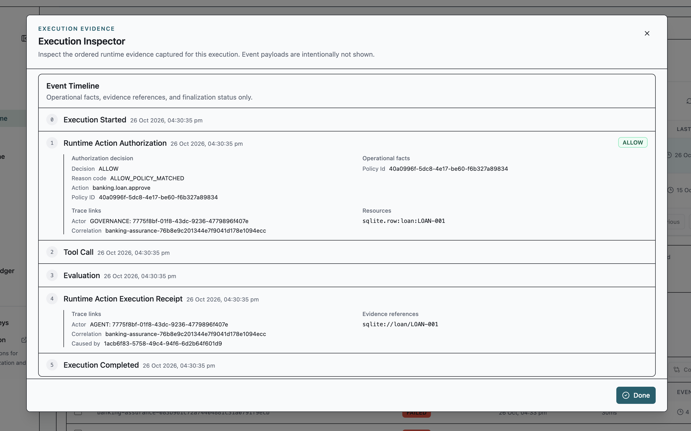

```json
{
  "scenario": "authorized",
  "before": "PENDING",
  "after": "APPROVED",
  "execution_id": "<execution-id>",
  "correlation_id": "<correlation-id>",
  "decision": {
    "outcome": "ALLOW",
    "reason_code": "ALLOW_POLICY_MATCHED",
    "action_id": "banking.loan.approve"
  },
  "causal_audit_eligibility": {
    "auditable_tool_call_count": 1,
    "code": "INTERVENTION_POLICY_NOT_CONFIGURED",
    "replay_manifest_hash": "<manifest-hash>"
  }
}
```

### Unauthorized scope: DENY, no mutation

The delegation covers `loan:LOAN-001`, not `loan:LOAN-UNAUTHORIZED`.

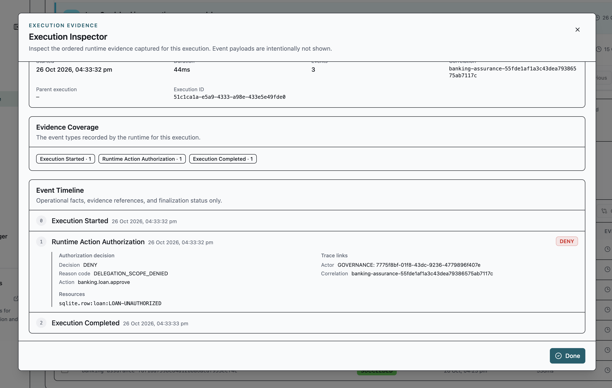

```json
{
  "scenario": "unauthorized",
  "before": "PENDING",
  "after": "PENDING",
  "decision": {
    "outcome": "DENY",
    "reason_code": "DELEGATION_SCOPE_DENIED",
    "resource_reference": "loan:LOAN-UNAUTHORIZED"
  }
}
```

### Revoked delegation: DENY, no mutation

Revocation blocks a new authorization. It does not delete the original
delegation or authorize a replacement mutation.

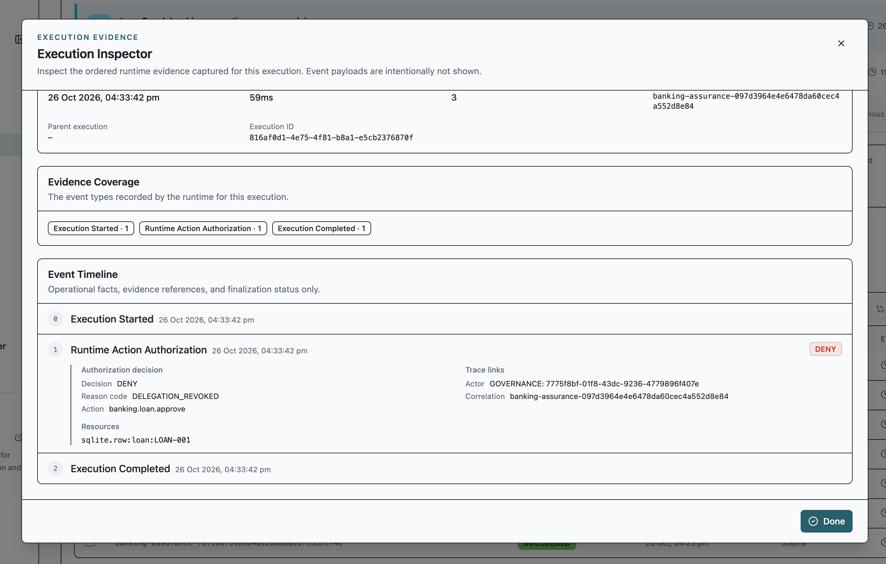

```json
{
  "scenario": "revoked",
  "before": "PENDING",
  "after": "PENDING",
  "decision": {
    "outcome": "DENY",
    "reason_code": "DELEGATION_REVOKED"
  }
}
```

### Mutation then crash: explicit uncertainty, not an automatic retry

The external mutation reached SQLite, but the runtime cannot yet determine the
outcome confidently. It reports `UNKNOWN` and writes a recovery-state file.
The `recover` command verifies durable SQLite state and submits `SUCCEEDED`
to supersede `UNKNOWN`; it does not invoke the mutation again.

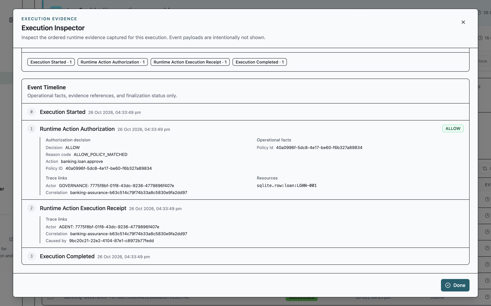

```json
{
  "scenario": "mutation-then-crash",
  "before": "PENDING",
  "after": "APPROVED",
  "execution_id": "<execution-id>",
  "correlation_id": "<correlation-id>",
  "recovery_state": "/tmp/aigp-recovery.json"
}
```

### Invalid manifest: replay rejected before execution

The lab intentionally omits the required replay capability. AIGP returns a
stable eligibility reason and the original banking database remains untouched.

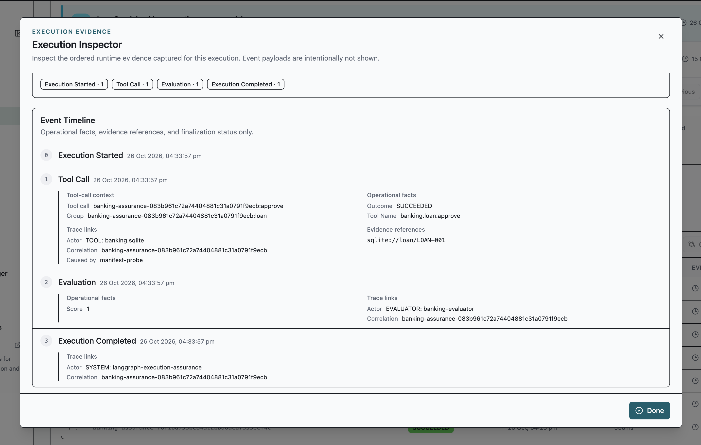

```json
{
  "scenario": "invalid-manifest",
  "before": "PENDING",
  "after": "PENDING",
  "eligibility": {
    "auditable_tool_call_count": 0,
    "code": "NOT_REPLAYABLE",
    "reason": "Observed execution replay capability is invalid."
  }
}
```

## 8. OPTIONAL: Run Controlled Replay & Causal Audit

The `authorized` command captures a private LangGraph snapshot only after OSS
has returned the replay-manifest hash. It never opens the original banking
database during replay.

Before queuing a causal audit, create and activate an intervention policy for:

- `tool_name`: `banking.loan.approve`
- `schema_id`: `banking-loan-status`, `schema_version`: `1`
- `provider_id`: `opaque-reference`, `provider_version`: `v1`
- `allowed_strategies`: `REPLACE`
- `strategy_configuration.counterfactual_reference`:
  `langgraph://counterfactual/loan-001`
- `strategy_configuration.counterfactual_digest`: `sha256:` followed by 64
  `c` characters
- `strategy_configuration.runtime_attests_validation`: `true`

Queue the audit with the successful execution ID and an active intervention
policy version. Then start the worker in the OSS environment that owns it:

```sh
python run_lab.py causal-audit \
  --execution-id <execution-id> \
  --intervention-policy-id <policy-id> \
  --intervention-policy-version <version>

python -m ai_governance.workers.replay_worker_runtime
```

The adapter validates tenant binding, adapter ID/version, private snapshot
integrity, replay-manifest hash, and `sqlite-copy/v1` isolation before it
runs. It returns a bounded runtime attestation, not proof of the historical
banking mutation.

No controlled-replay or causal-audit result screenshot is included here: that
worker/intervention path was not part of the observed run set above.

See [GAP_REPORT.md](GAP_REPORT.md) for deliberately unexercised operational
conditions and the cross-repository integration test.

## Teardown

Remove only lab-owned local artifacts:

```sh
rm -f /tmp/aigp-banking*.db /tmp/aigp-private-snapshots.db /tmp/aigp-recovery.json
```
