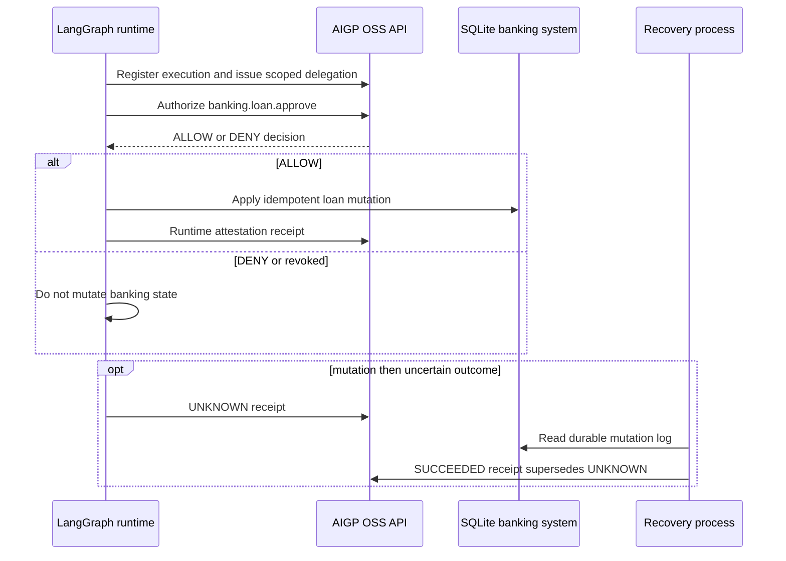
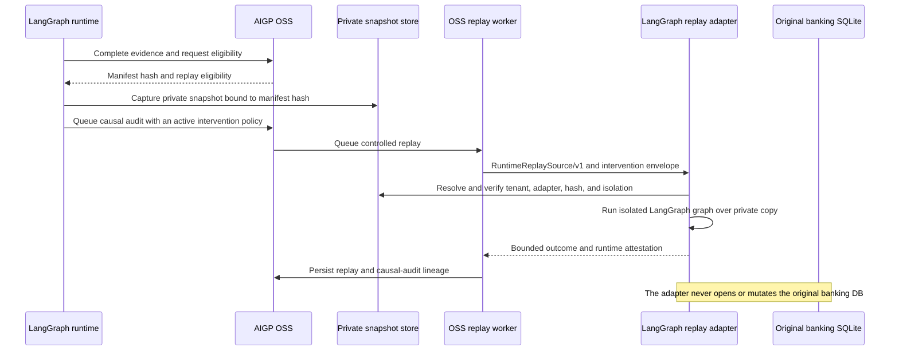

# LangGraph execution-assurance lab

This is the advanced companion to `langgraph-governed-operations-intg`.
That untouched lab teaches foundational runtime authorization. This independent
lab uses the same public OSS APIs to show the full supported banking lifecycle:
an authenticated LangGraph runtime asks AIGP for one operation-bound permit,
mutates its own SQLite database, and submits bounded receipt evidence.

It does **not** import, invoke, or depend on the foundational lab.

## Architecture



OSS owns the authorization decision and append-only evidence. LangGraph owns
orchestration and enforcement. SQLite is an external application owned by this
lab. A receipt authenticates the runtime's bounded claim; it is not AIGP proof
that SQLite changed. Recovery reads SQLite's idempotent mutation log and never
replays the original write.

For controlled replay, the direction and ownership remain deliberately
different:



`RuntimeReplaySource/v1` carries only an opaque reference and bounded binding
claims. A manifest hash detects inconsistency between the governed manifest and
the runtime snapshot; it does not establish that the snapshot, receipt, or
external mutation is independently true.

## Prerequisites

1. Start a compatible OSS API in development authentication mode or provide
   real bearer credentials.
2. Configure an active runtime-action policy for `banking.loan.approve` on
   `sqlite.row`, plus an issuer policy that permits the issuer to create the
   exact delegation. The lab deliberately does not create governance policy.
3. Create a virtual environment and install this lab:

```sh
cd labs/agent-frameworks/langgraph/langgraph-execution-assurance-lab
python -m venv .venv
. .venv/bin/activate
python -m pip install --no-cache-dir --upgrade -r requirements.txt
```

4. Install the released Plugin API and separately owned LangGraph replay
adapter into the environment that runs the replay worker. It is not an OSS or
lab dependency on the foundational lab:

```sh
pip install -e ../../../../adapters/aigp-langgraph-replay-adapter
export AIGP_LANGGRAPH_REPLAY_SNAPSHOT_DB=/tmp/aigp-langgraph-private-snapshots.db
```

When developing the Plugin API itself rather than using a released contract,
replace the first command with:

```sh
pip install -e ../../../../ai-governance-oss/packages/bhanuj-governance-plugin-api
```

The private snapshot database is runtime-owned. Do not mount it into the OSS
API process unless that process is also deliberately configured to run the
replay worker. A worker without the adapter can leave an otherwise eligible
execution unexecuted; adapter deployment is operational availability, not
historical replay eligibility.

Configure only credentials supplied through your local secure environment:

```sh
export AIGP_BASE_URL=http://localhost:8000
export AIGP_ORGANIZATION_ID=org_default
export AIGP_PROJECT_ID=project_default
export AIGP_RUNTIME_ACTOR_ID=runtime-service
export AIGP_ISSUER_ACTOR_ID=delegation-service
export AIGP_ISSUER_TOKEN='issuer-token'
# Optional when API authentication requires it:
export AIGP_RUNTIME_TOKEN='runtime-token'
```

## Run execution lifecycle

Each command prints stable correlation and execution IDs plus SQLite state.
Use a fresh directory or delete `banking.db` and `recovery-state.json` to reset.

```sh
python run_lab.py authorized --database /tmp/aigp-banking.db
python run_lab.py unauthorized --database /tmp/aigp-banking-denied.db
python run_lab.py revoked --database /tmp/aigp-banking-revoked.db
python run_lab.py crash --database /tmp/aigp-banking-recovery.db --state /tmp/aigp-recovery.json
python run_lab.py recover --database /tmp/aigp-banking-recovery.db --state /tmp/aigp-recovery.json
python run_lab.py invalid-manifest --database /tmp/aigp-banking-invalid.db
pytest -q
```

Expected properties:

| Scenario | Assertion |
| --- | --- |
| `authorized` | AIGP ALLOW, `PENDING → APPROVED`, tool evidence and `SUCCEEDED` receipt. |
| `unauthorized` | AIGP denies an out-of-delegation resource; SQLite remains `PENDING`. |
| `revoked` | Revocation prevents a new authorization; SQLite remains `PENDING`. |
| `crash` | SQLite reaches `APPROVED`; an `UNKNOWN` receipt and recovery state are persisted. |
| `recover` | SQLite mutation is not repeated; a `SUCCEEDED` receipt supersedes `UNKNOWN`. |
| `invalid-manifest` | AIGP Causal Audit eligibility returns `NOT_REPLAYABLE` before replay planning. |

The `authorized` run records a complete trace: authorization event → SQLite
tool evidence → receipt → replay manifest hash → private snapshot binding.
Query `GET /api/v1/agent-executions/{execution_id}` or open **Agents Runtime**
in Studio and filter by the emitted correlation ID. A bounded shape is shown
in [examples/authorized-output.json](examples/authorized-output.json).

## Run controlled replay and causal audit

The `authorized` command captures a private LangGraph snapshot only after OSS
has returned the final replay-manifest hash. It does not access the banking
database during replay.

Before queuing a causal audit, create and activate an intervention policy for:

- `tool_name`: `banking.loan.approve`
- `schema_id`: `banking-loan-status`, `schema_version`: `1`
- `provider_id`: `opaque-reference`, `provider_version`: `v1`
- `allowed_strategies`: `REPLACE`
- `strategy_configuration.counterfactual_reference`:
  `langgraph://counterfactual/loan-001`
- `strategy_configuration.counterfactual_digest`:
  `sha256:` followed by 64 `c` characters
- `strategy_configuration.runtime_attests_validation`: `true`

This is deliberately a reference-only policy. OSS authorizes the intervention
without receiving private snapshot contents. With the successful execution ID
and the active policy version, queue the audit and then run a worker configured
with the adapter and the same private snapshot database:

```sh
python run_lab.py causal-audit \
  --execution-id <execution-id> \
  --intervention-policy-id <policy-id> \
  --intervention-policy-version <version>

# In the OSS environment that owns the replay worker:
python -m ai_governance.workers.replay_worker_runtime
```

Inspect `GET /api/v1/agents-runtime/causal-audits/<audit-id>` (or the Causal
Audit view in Studio, where enabled). Its lineage links the authorization,
receipt, manifest, replay execution, and causal result. The adapter validates
the private snapshot integrity, tenant binding, adapter identity, manifest hash
and declared `sqlite-copy/v1` isolation before it runs. It returns a bounded
runtime attestation, not proof of a historical banking mutation.

See [GAP_REPORT.md](GAP_REPORT.md) for deliberately unexercised operational
conditions and the cross-repository integration test.

## Teardown

Remove only lab-owned artifacts:

```sh
rm -f /tmp/aigp-banking*.db /tmp/aigp-recovery.json
```
