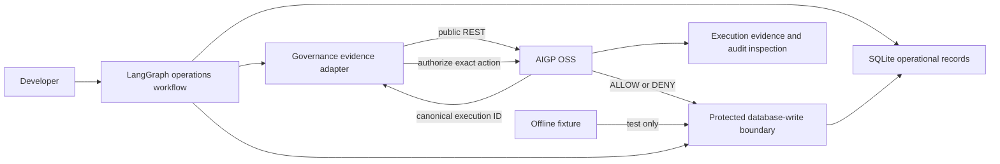
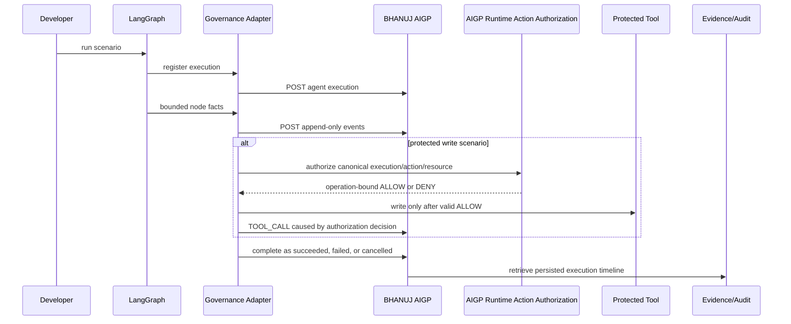

# Build a LangGraph operations assistant with BHANUJ AIGP authorization and evidence

This hands-on guide adds authoritative BHANUJ AIGP runtime-action
authorization and execution evidence to a small LangGraph agent. LangGraph
still owns execution and the local SQLite tool. AIGP owns the canonical
execution identity, persisted authorization decision, accepted evidence, and
terminal state through public OSS REST APIs.

The guide uses one progressive integration and seven scenarios:

| Scenario | What it demonstrates | SQLite `OPS-001` result |
| --- | --- | --- |
| `readonly` | Unprotected read, with or without evidence configuration | `PENDING` |
| `aigp` | Actual AIGP policy decision before the protected write | Policy-dependent |
| `allowed` | Simulated allow decision before the protected write | `MAINTENANCE` |
| `denied` | Simulated denial blocks the protected write | `PENDING` |
| `outage` | Simulated authorization outage fails the protected write closed | `PENDING` |
| `registration-failure` | Registration delivery fails; the read still completes | `PENDING` |
| `evidence-failure` | Event delivery fails after registration; no terminal success is invented | `PENDING` |

`aigp` is the only authoritative protected-write scenario. It calls
`POST /api/v1/runtime-action-authorizations/authorize` immediately before the
SQLite mutation and fails closed unless a matching, unexpired `ALLOW` is
returned. `allowed`, `denied`, and `outage` remain deterministic **offline lab
fixtures**. They are explicitly labelled `simulated-lab-fixture` in evidence
and are not an AIGP policy decision or a security control.

Read [CONTRACT_COMPATIBILITY.md](CONTRACT_COMPATIBILITY.md) and [FAILURE_MODES.md](FAILURE_MODES.md) before extending the integration.

## Architecture





## Prerequisites

- Python 3.12 or later
- `pip`
- A local clone of `ai-governance-oss` for Chapters 2 onward

```bash
cd agent-frameworks/langgraph/langgraph-governed-operations-intg
python3 -m venv .venv
source .venv/bin/activate
python -m pip install --upgrade pip
python -m pip install -r requirements.txt
```

The fixture scenarios use only this lab environment. The authoritative `aigp`
scenario and real-API tests also import the OSS runtime-authorization SDK, which
loads its package-level control-plane contracts. Prepare the OSS checkout's
normal environment once:

```bash
cd /path/to/ai-governance-oss
uv sync
```

For authoritative commands below, retain the lab directory as `LAB_ROOT` and
point `OSS_ROOT` at that synchronized checkout. The commands add only the
lab's LangGraph site-packages to the OSS interpreter; they do not install an
incomplete `--no-deps` copy of the OSS package into the lab virtualenv.

## 1. Build Agent

The agent reads a local operational record, optionally proposes a status change, and has exactly one SQLite mutation path: `protected_database_write`.

```bash
python app.py readonly --database /tmp/bhanuj-langgraph-readonly.db
```

Expected checkpoint:

```text
Outcome: READ_COMPLETED
SQLite record status: PENDING
AIGP evidence status: DISABLED
```

The agent is usable without AIGP for this unprotected operation. No model, cloud dependency, or paid API is required.

## 2. Register Execution

Start the Compose-based OSS stack from its own checkout in a separate terminal. This is the verified local path used by this guide; the API is exposed on port `8000`.

```bash
cd /path/to/ai-governance-oss
./servers.sh up
./servers.sh ps
curl --fail http://localhost:8000/ready
```

Before starting the stack, configure the `ai-governance-platform` service for local development authentication:

```text
# .env.platform
AI_GOVERNANCE_AUTH_MODE=development

# docker-compose.yml → services.ai-governance-platform → environment
AI_GOVERNANCE_AUTH_MODE: development
```

Compose `environment` values override values from `env_file`. Therefore, if `docker-compose.yml` explicitly sets the platform mode to `keycloak`, changing only `.env.platform` does **not** change the API running on port `8000`. Keep the two values aligned when other Compose services load `.env.platform`; the explicit platform value is the effective source for the REST API. This lab does not call the MCP HTTP container, so do not change its separate authentication setting for this tutorial.

Back in this lab, configure the existing public API contract. `.env.example` is a template; export the values in your shell or load them with your preferred local environment tool.

```bash
export AI_GOVERNANCE_BASE_URL=http://localhost:8000
export AI_GOVERNANCE_ORGANIZATION_ID=org_default
export AI_GOVERNANCE_PROJECT_ID=project_default
export AI_GOVERNANCE_ACTOR_ID=local-admin
export AI_GOVERNANCE_RUNTIME_ACTOR_ID=local-admin
python app.py readonly --database /tmp/bhanuj-langgraph-registered.db
```

If you intentionally target a Keycloak-authenticated API instead, retain its URL and set `AI_GOVERNANCE_ACCESS_TOKEN` to a valid bearer token. A `401` means that API rejected the supplied credentials; organization, project, and actor headers alone do not authenticate a request.

### Obtain Keycloak Auth Token

This is the **same LangGraph integration and the same public REST contract** as the development-authentication path above. Only the API authentication method changes. Use it when `ai-governance-platform` is configured with `AI_GOVERNANCE_AUTH_MODE=keycloak`.

First, ensure both effective Compose configuration layers select Keycloak, then start the local stack. After changing either value, run `./servers.sh up` so Compose applies the updated platform configuration.

```text
# .env.platform
AI_GOVERNANCE_AUTH_MODE=keycloak

# docker-compose.yml → services.ai-governance-platform → environment
AI_GOVERNANCE_AUTH_MODE: keycloak
```

```bash
cd /path/to/ai-governance-oss
./servers.sh up

# This file is generated by the local startup flow with restrictive permissions.
set -a
source .env.oauth.generated
set +a

# Exchange the local walkthrough service-client credentials for one short-lived token.
# Do not echo, commit, or paste the token into documentation.
ACCESS_TOKEN="$(uv run python -c '
from ai_governance.oauth.client_credentials import access_token_from_environment
print(access_token_from_environment())
')"
test -n "$ACCESS_TOKEN"
```

The generated local client represents a service account, not an administrator or an impersonated person. The API still validates that principal's tenant membership and RBAC permissions. For a non-local system, create a least-privilege confidential client and supply `AI_GOVERNANCE_OAUTH_TOKEN_URL`, `AI_GOVERNANCE_OAUTH_CLIENT_ID`, and `AI_GOVERNANCE_OAUTH_CLIENT_SECRET` from a secret manager or protected CI environment; do not reuse the local walkthrough credentials.

Back in the lab, use the obtained token. In Keycloak mode the token identifies the caller, so omit the development-only actor override:

```bash
export AI_GOVERNANCE_BASE_URL=http://localhost:8000
export AI_GOVERNANCE_ORGANIZATION_ID=org_default
export AI_GOVERNANCE_PROJECT_ID=project_default
export AI_GOVERNANCE_ACCESS_TOKEN="$ACCESS_TOKEN"
# This must be the service principal subject AIGP derives from the token. It
# is used locally to validate the returned decision and is not sent as a claim.
export AI_GOVERNANCE_RUNTIME_ACTOR_ID="service-account-subject"
unset AI_GOVERNANCE_ACTOR_ID

python app.py readonly --database /tmp/bhanuj-langgraph-keycloak.db

# Remove the in-shell copy when you finish this session.
unset ACCESS_TOKEN AI_GOVERNANCE_ACCESS_TOKEN
```

Expected checkpoint:

```text
Outcome: READ_COMPLETED
AIGP execution ID: <uuid>
AIGP evidence status: COMPLETED
```

`POST /api/v1/agent-executions` receives the LangGraph run ID as its external
execution ID and returns the canonical AIGP `execution_id`. The lab sends only
bounded metadata: workflow name/version, `model_reference=none`, operation
intent, run ID, and optional thread ID. It sends no prompt, raw record,
response, credential, executable state, or reasoning trace.

### Execution Identity & Lifecycle

| Identity | Owner | Adapter use |
| --- | --- | --- |
| `execution_id` | AIGP | Returned once by registration; required for authorization, evidence, retrieval, and finalization. |
| `langgraph_run_id` | LangGraph | One actual invocation identity; sent as AIGP `external_execution_id`, correlation basis, and idempotency basis. |
| `langgraph_thread_id` | LangGraph | Optional workflow/checkpoint continuity metadata only; never an AIGP execution key. |

Retrying registration for the same run ID is idempotent and resolves the same
canonical AIGP execution. A resumed logical invocation retains its run ID; a
new invocation on the same thread must supply a new run ID and therefore gets
a distinct AIGP execution. Node and tool IDs remain subordinate evidence
identities. The adapter does not finalize a process-abandoned run; an explicit
interruption becomes `CANCELLED`, never `SUCCEEDED`.

## 3. Capture Evidence

Before an authoritative write, create and activate an AIGP policy version that
targets `AgentExecution` and registers this exact operation in its definition
metadata:

```json
{
  "runtime_action_authorization": {
    "purpose": "runtime_action_authorization",
    "registered_actions": ["operations.update_status"],
    "registered_resource_types": ["sqlite.row"]
  }
}
```

Use structured policy conditions such as `action.id`, `resource.type`,
`resource.reference`, `actor.id`, or bounded `context.intent`. AIGP maps an
`APPROVE` rule to `ALLOW`; `REJECT` and `BLOCK` to `DENY`. See the control-plane
[Runtime Action Authorization guide](../../../../ai-governance-oss/docs/tutorials/runtime-action-authorization.md)
for the full policy contract.

Run the real protected-write scenario while the API and policy remain
configured:

```bash
LAB_ROOT="$(pwd)"
OSS_ROOT=/path/to/ai-governance-oss
LAB_SITE_PACKAGES="$("$LAB_ROOT/.venv/bin/python" -c 'import site; print(site.getsitepackages()[0])')"
PYTHONPATH="$LAB_ROOT:$LAB_SITE_PACKAGES" \
  "$OSS_ROOT/.venv/bin/python" "$LAB_ROOT/app.py" aigp \
  --database /tmp/bhanuj-langgraph-aigp.db
```

Expected checkpoint:

```text
Outcome: WRITE_COMPLETED
SQLite record status: MAINTENANCE
AIGP evidence status: COMPLETED
```

The adapter uses these verified OSS contracts:

| Fact | Public contract | Data retained by the lab |
| --- | --- | --- |
| Execution start | `POST /api/v1/agent-executions` | LangGraph execution/correlation IDs, workflow metadata |
| Node lifecycle | `POST /api/v1/agent-executions/{id}/events` with `WORKFLOW_STEP` | Stable step ID, lifecycle, `source_kind=langgraph.node` |
| Runtime authorization | `POST /api/v1/runtime-action-authorizations/authorize` | Canonical execution ID, registered action/resource, bounded context, idempotency key |
| Protected tool | The same event endpoint with `TOOL_CALL` | Tool-call context, action name, bounded resource reference, outcome |
| Offline fixture decision | The same event endpoint with `GOVERNANCE_DECISION` | Simulation source, outcome, reason code; never claimed as AIGP policy output |
| Failure | The same event endpoint with `ERROR` | Error class and bounded reason code |
| Terminal state | `POST /api/v1/agent-executions/{id}/complete` | `SUCCEEDED`, `FAILED`, or `CANCELLED` |

Each request is tenant-scoped with the existing `X-AI-Governance-*` headers.
The authorization body never carries tenant or actor claims; AIGP resolves them
from the authenticated server context. Event idempotency keys are deterministic;
transient evidence-delivery retries stop after three attempts. Evidence is
delivered synchronously and serially in this small adapter, so it has no local
queue or durable buffer: ordering is preserved, and a permanent failure is
surfaced as `DEGRADED` rather than hidden or replayed from a private outbox.
There is consequently no queue to saturate: the graph invocation itself applies
backpressure while one delivery is in progress (at most three five-second
transport attempts, plus the small retry delays). After that bound is exhausted,
the reporter stops delivery for the run. An operator should inspect the
registered execution if one exists, correct the control-plane issue, and begin
a new LangGraph run with a new run ID; this adapter never replays a private
backlog.

## 4. Offline Fixture Scenarios

These deterministic scenarios are retained for educational and offline tests.
They do not call the AIGP authorization endpoint and must not be used as a
security boundary.

```bash
# Simulated allow: this is educational fixture behavior, not authorization.
python app.py allowed --database /tmp/bhanuj-langgraph-allowed.db

# Simulated deny: no SQLite mutation is possible on this path.
python app.py denied --database /tmp/bhanuj-langgraph-denied.db

# Simulated authorizer outage: protected write fails closed.
python app.py outage --database /tmp/bhanuj-langgraph-outage.db
```

Expected checkpoints:

| Scenario | Outcome | Terminal execution state | SQLite state |
| --- | --- | --- | --- |
| `allowed` | `WRITE_COMPLETED` | `SUCCEEDED` | `MAINTENANCE` |
| `denied` | `WRITE_DENIED` | `SUCCEEDED` (the denial was handled) | `PENDING` |
| `outage` | `GOVERNANCE_UNAVAILABLE` | `FAILED` | `PENDING` |

The database call appears only after the simulated allow branch. Because no
actual tool invocation occurs for a denied or unavailable request, those
branches emit no `TOOL_CALL` event. An unavailable fixture also emits bounded
`AuthorizationUnavailable` error evidence. In contrast, the `aigp` scenario
records the authoritative `RUNTIME_ACTION_AUTHORIZATION` event in AIGP; its
actual `TOOL_CALL` cites that decision ID as `causation_id`.

## 5. Handle Failures

Keep AIGP configuration from Chapter 2 exported, then run the delivery-failure scenarios. They use a lab-only transport fault injector around the same public REST client; they are not alternate execution architectures.

```bash
# The API is never contacted for registration; LangGraph read still completes.
python app.py registration-failure --database /tmp/bhanuj-langgraph-registration-failure.db

# Registration succeeds, then event delivery exhausts bounded retries.
python app.py evidence-failure --database /tmp/bhanuj-langgraph-evidence-failure.db

# A lifecycle interruption cancels the execution without a write.
python app.py readonly --interrupt-after-read \
  --database /tmp/bhanuj-langgraph-interrupted.db
```

Expected checkpoints:

| Case | Business outcome | Evidence outcome |
| --- | --- | --- |
| Registration failure | `READ_COMPLETED` | `DEGRADED`; no fabricated execution or completion |
| Evidence failure | `READ_COMPLETED` | `DEGRADED`; accepted start remains inspectable, no fabricated completion |
| Interrupted run | `INTERRUPTED` | `CANCELLED` terminal execution and no database mutation |

Evidence is intentionally failure-isolated from the read-only business result.
Protected writes remain fail-closed on AIGP denial, authorization timeout,
unavailable service, malformed response, invalid binding, expiry, or a missing
canonical execution. [FAILURE_MODES.md](FAILURE_MODES.md) specifies delivery,
workflow, and finalization behavior in full.

## 6. Inspect Evidence

Copy the printed AIGP execution ID from a successful run and retrieve its tenant-scoped record:

```bash
curl "$AI_GOVERNANCE_BASE_URL/api/v1/agent-executions/EXECUTION_ID" \
  -H "X-AI-Governance-Organization-Id: $AI_GOVERNANCE_ORGANIZATION_ID" \
  -H "X-AI-Governance-Project-Id: $AI_GOVERNANCE_PROJECT_ID" \
  -H "X-AI-Governance-Actor-Id: ${AI_GOVERNANCE_ACTOR_ID:-local-admin}"
```

For an authoritative `aigp` allow run, verify all of the following in `events`:

- one `EXECUTION_STARTED` and one terminal `EXECUTION_COMPLETED`;
- paired `WORKFLOW_STEP` start/completion records;
- one `RUNTIME_ACTION_AUTHORIZATION` event with `authorization_outcome=ALLOW`;
- one `TOOL_CALL` record for the actual SQLite invocation, with a version-`1` `tool_call_context` and `attributes.outcome=SUCCEEDED`;
- the `TOOL_CALL.causation_id` equal to the authorization decision event ID;
- event `correlation_id` values matching the printed external execution ID.

The OSS contract makes `runtime_tool_call_id` unique within an execution, so
this guide does not invent a second request-phase `TOOL_CALL` event for the
same native call. The authorization event records a decision, not proof of a
tool invocation; the later `TOOL_CALL` is the runtime's evidence that the tool
actually ran. Fixture scenarios instead show their separate
`GOVERNANCE_DECISION` event labelled `simulated-lab-fixture`.

## 7. Understand Boundaries

- **LangGraph owns execution.** BHANUJ AIGP does not schedule graph nodes, run SQLite, or orchestrate the agent.
- **AIGP owns accepted evidence.** The lab uses public registration, event-ingestion, retrieval, and finalization routes only; it never accesses BHANUJ persistence or graph storage.
- **AIGP authorizes; LangGraph enforces.** The `aigp` boundary checks an
  operation-bound response immediately before SQLite. A bypassed wrapper or a
  later change to the resource remains outside AIGP's control.
- **Fixtures are not authorization.** `allowed`, `denied`, and `outage` are
  offline teaching fixtures, not production-safe permission decisions.
- **Causal audit and replay are limitations.** The lab records `ToolCallContext`, but provides neither a replay provider nor a causal-audit demonstration. It does not claim the SQLite tool is replayable.
- **Finalization is not sealing.** Completing an execution is distinct from evidence sealing, deterministic replay, and counterfactual simulation.

## Tests and Reproducibility

Run deterministic unit tests without a AIGP instance:

```bash
python -m pytest -q
```

They verify real SQLite state, sync and async invocation, AIGP request binding,
same-thread run isolation, registration/evidence failures, fixture outage error
evidence, interruption/failed finalization, and idempotent delivery. The
optional local-API test is skipped unless it is explicitly enabled, even if a
base URL remains exported in your shell.

To execute the real OSS API integration test, start the API as in Chapter 2 and run:

```bash
export BHANUJ_LAB_INTEGRATION_BASE_URL=http://localhost:8000
export BHANUJ_LAB_INTEGRATION_ORGANIZATION_ID=org_default
export BHANUJ_LAB_INTEGRATION_PROJECT_ID=project_default
export BHANUJ_LAB_INTEGRATION_ACTOR_ID=local-admin
export BHANUJ_LAB_INTEGRATION_ENABLED=true
LAB_ROOT="$(pwd)"
OSS_ROOT=/path/to/ai-governance-oss
LAB_SITE_PACKAGES="$("$LAB_ROOT/.venv/bin/python" -c 'import site; print(site.getsitepackages()[0])')"
PYTHONPATH="$LAB_ROOT:$LAB_SITE_PACKAGES" \
  "$OSS_ROOT/.venv/bin/python" -m pytest -m integration -q
```

This test submits actual HTTP requests to the running OSS API, retrieves
persisted execution records, validates correlation and terminal state, and
proves duplicate event delivery creates one logical event. The Chapter 2 server
command uses development authentication. If you instead target a
token-authenticated API, also export a valid
`BHANUJ_LAB_INTEGRATION_ACCESS_TOKEN`; a `401` is an environment-credential
failure, not a passing integration result.

For the Keycloak path above, preserve `ACCESS_TOKEN` until after the test and
replace the development actor exports in the preceding command with these
values. The runtime actor must be the token subject; do not send a
development-only actor header in Keycloak mode.

```bash
export BHANUJ_LAB_INTEGRATION_ACCESS_TOKEN="$ACCESS_TOKEN"
export BHANUJ_LAB_INTEGRATION_ACTOR_ID=""
export BHANUJ_LAB_INTEGRATION_RUNTIME_ACTOR_ID="$AI_GOVERNANCE_RUNTIME_ACTOR_ID"
# Run the preceding OSS-interpreter pytest command here.
unset BHANUJ_LAB_INTEGRATION_ACCESS_TOKEN ACCESS_TOKEN
```

## Repository Structure

```text
.
├── .env.example
├── app.py
├── CONTRACT_COMPATIBILITY.md
├── FAILURE_MODES.md
├── governance.py
├── operations.py
├── policy.py
├── pytest.ini
├── requirements.txt
├── tests/
│   ├── test_oss_api_integration.py
│   └── test_workflow.py
└── workflow.py
```
