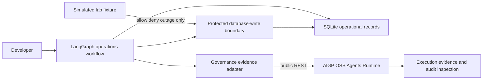
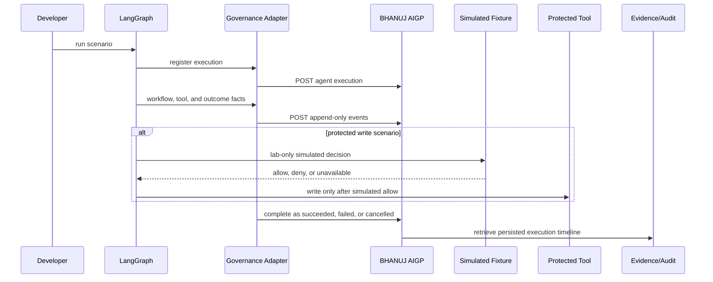

# Build a LangGraph operations assistant with BHANUJ AIGP evidence

This is a hands-on developer guide for adding **BHANUJ AIGP execution evidence** to a small LangGraph agent. It is intentionally educational: LangGraph owns agent execution and the local SQLite tool; BHANUJ receives execution registration, runtime evidence, and terminal state through its public OSS REST API.

The guide uses one progressive integration and six scenarios:

| Scenario | What it demonstrates | SQLite `OPS-001` result |
| --- | --- | --- |
| `readonly` | Unprotected read, with or without evidence configuration | `PENDING` |
| `allowed` | Simulated allow decision before the protected write | `MAINTENANCE` |
| `denied` | Simulated denial blocks the protected write | `PENDING` |
| `outage` | Simulated authorization outage fails the protected write closed | `PENDING` |
| `registration-failure` | Registration delivery fails; the read still completes | `PENDING` |
| `evidence-failure` | Event delivery fails after registration; no terminal success is invented | `PENDING` |

`allowed`, `denied`, and `outage` are **deterministic lab fixtures**, not AIGP policy decisions and not a security guarantee. OSS has no public external operation-authorization API for a LangGraph tool to submit `actor + action + resource` for an authoritative decision. The fixture is deliberately labelled in evidence as `simulated-lab-fixture`; do not reuse it outside this guide.

Read [CONTRACT_COMPATIBILITY.md](CONTRACT_COMPATIBILITY.md) and [FAILURE_MODES.md](FAILURE_MODES.md) before extending the integration.

## Architecture





## Prerequisites

- Python 3.12 or later
- `pip`
- A local clone of `ai-governance-oss` for Chapters 2 onward

```bash
cd agent-frameworks/langgraph/langgraph-governed-operations-intg
python3 -m venv .venv
source .venv/bin/activate
python -m pip install --upgrade pip
python -m pip install -r requirements.txt
```

## 1. Build the agent

The agent reads a local operational record, optionally proposes a status change, and has exactly one SQLite mutation path: `protected_database_write`.

```bash
python app.py readonly --database /tmp/bhanuj-langgraph-readonly.db
```

Expected checkpoint:

```text
Outcome: READ_COMPLETED
SQLite record status: PENDING
AIGP evidence status: DISABLED
```

The agent is usable without AIGP for this unprotected operation. No model, cloud dependency, or paid API is required.

## 2. Register execution

Start the Compose-based OSS stack from its own checkout in a separate terminal. This is the verified local path used by this guide; the API is exposed on port `8000`.

```bash
cd /path/to/ai-governance-oss
./servers.sh up
./servers.sh ps
curl --fail http://localhost:8000/ready
```

Before starting the stack, configure the `ai-governance-platform` service for local development authentication:

```text
# .env.platform
AI_GOVERNANCE_AUTH_MODE=development

# docker-compose.yml → services.ai-governance-platform → environment
AI_GOVERNANCE_AUTH_MODE: development
```

Compose `environment` values override values from `env_file`. Therefore, if `docker-compose.yml` explicitly sets the platform mode to `keycloak`, changing only `.env.platform` does **not** change the API running on port `8000`. Keep the two values aligned when other Compose services load `.env.platform`; the explicit platform value is the effective source for the REST API. This lab does not call the MCP HTTP container, so do not change its separate authentication setting for this tutorial.

Back in this lab, configure the existing public API contract. `.env.example` is a template; export the values in your shell or load them with your preferred local environment tool.

```bash
export AI_GOVERNANCE_BASE_URL=http://localhost:8000
export AI_GOVERNANCE_ORGANIZATION_ID=org_default
export AI_GOVERNANCE_PROJECT_ID=project_default
export AI_GOVERNANCE_ACTOR_ID=local-admin
python app.py readonly --database /tmp/bhanuj-langgraph-registered.db
```

If you intentionally target a Keycloak-authenticated API instead, retain its URL and set `AI_GOVERNANCE_ACCESS_TOKEN` to a valid bearer token. A `401` means that API rejected the supplied credentials; organization, project, and actor headers alone do not authenticate a request.

Expected checkpoint:

```text
Outcome: READ_COMPLETED
AIGP execution ID: <uuid>
AIGP evidence status: COMPLETED
```

`POST /api/v1/agent-executions` receives the LangGraph external execution ID and correlation ID. The lab sends only bounded metadata: workflow name/version, `model_reference=none`, and operation intent. It sends no prompt, raw record, response, credential, or reasoning trace.

## 3. Capture evidence

Run a protected-write scenario while the API remains configured:

```bash
python app.py allowed --database /tmp/bhanuj-langgraph-allowed.db
```

Expected checkpoint:

```text
Outcome: WRITE_COMPLETED
SQLite record status: MAINTENANCE
AIGP evidence status: COMPLETED
Decision source: simulated lab fixture (not a AIGP authorizer)
```

The adapter uses these verified OSS contracts:

| Fact | Public contract | Data retained by the lab |
| --- | --- | --- |
| Execution start | `POST /api/v1/agent-executions` | LangGraph execution/correlation IDs, workflow metadata |
| Node lifecycle | `POST /api/v1/agent-executions/{id}/events` with `WORKFLOW_STEP` | Stable step ID, lifecycle, `source_kind=langgraph.node` |
| Protected tool | The same event endpoint with `TOOL_CALL` | Tool-call context, action name, bounded resource reference, outcome |
| Simulated decision | The same event endpoint with `GOVERNANCE_DECISION` | Simulation source, outcome, reason code; never claimed as AIGP policy output |
| Failure | The same event endpoint with `ERROR` | Error class and bounded reason code |
| Terminal state | `POST /api/v1/agent-executions/{id}/complete` | `SUCCEEDED`, `FAILED`, or `CANCELLED` |

Each request is tenant-scoped with the existing `X-AI-Governance-*` headers. Event idempotency keys are deterministic; transient delivery retries stop after three attempts. Event sequence numbers describe persisted ordering, while returned event IDs are used as causal links when delivery succeeds.

## 4. Simulate governance

The authorization layer is intentionally local to this lab. It shows where a future supported AIGP authorization adapter would sit, but it does not call a AIGP policy endpoint.

```bash
# Simulated allow: this is educational fixture behavior, not authorization.
python app.py allowed --database /tmp/bhanuj-langgraph-allowed.db

# Simulated deny: no SQLite mutation is possible on this path.
python app.py denied --database /tmp/bhanuj-langgraph-denied.db

# Simulated authorizer outage: protected write fails closed.
python app.py outage --database /tmp/bhanuj-langgraph-outage.db
```

Expected checkpoints:

| Scenario | Outcome | Terminal execution state | SQLite state |
| --- | --- | --- | --- |
| `allowed` | `WRITE_COMPLETED` | `SUCCEEDED` | `MAINTENANCE` |
| `denied` | `WRITE_DENIED` | `SUCCEEDED` (the denial was handled) | `PENDING` |
| `outage` | `GOVERNANCE_UNAVAILABLE` | `FAILED` | `PENDING` |

The database call appears only after the simulated allow branch. Because no actual tool invocation occurs for a denied or unavailable request, those branches emit no `TOOL_CALL` event. An unavailable fixture also emits bounded `AuthorizationUnavailable` error evidence.

## 5. Handle failures

Keep AIGP configuration from Chapter 2 exported, then run the delivery-failure scenarios. They use a lab-only transport fault injector around the same public REST client; they are not alternate execution architectures.

```bash
# The API is never contacted for registration; LangGraph read still completes.
python app.py registration-failure --database /tmp/bhanuj-langgraph-registration-failure.db

# Registration succeeds, then event delivery exhausts bounded retries.
python app.py evidence-failure --database /tmp/bhanuj-langgraph-evidence-failure.db

# A lifecycle interruption cancels the execution without a write.
python app.py readonly --interrupt-after-read \
  --database /tmp/bhanuj-langgraph-interrupted.db
```

Expected checkpoints:

| Case | Business outcome | Evidence outcome |
| --- | --- | --- |
| Registration failure | `READ_COMPLETED` | `DEGRADED`; no fabricated execution or completion |
| Evidence failure | `READ_COMPLETED` | `DEGRADED`; accepted start remains inspectable, no fabricated completion |
| Interrupted run | `INTERRUPTED` | `CANCELLED` terminal execution and no database mutation |

Evidence is intentionally failure-isolated from the read-only business result. Protected writes remain fail-closed on simulated authorization outage independently of evidence delivery. [FAILURE_MODES.md](FAILURE_MODES.md) specifies delivery, workflow, and finalization behavior in full.

## 6. Inspect evidence

Copy the printed AIGP execution ID from a successful run and retrieve its tenant-scoped record:

```bash
curl "$AI_GOVERNANCE_BASE_URL/api/v1/agent-executions/EXECUTION_ID" \
  -H "X-AI-Governance-Organization-Id: $AI_GOVERNANCE_ORGANIZATION_ID" \
  -H "X-AI-Governance-Project-Id: $AI_GOVERNANCE_PROJECT_ID" \
  -H "X-AI-Governance-Actor-Id: ${AI_GOVERNANCE_ACTOR_ID:-local-admin}"
```

For an allowed fixture run, verify all of the following in `events`:

- one `EXECUTION_STARTED` and one terminal `EXECUTION_COMPLETED`;
- paired `WORKFLOW_STEP` start/completion records;
- one `TOOL_CALL` record for the actual SQLite invocation, with a version-`1` `tool_call_context` and `attributes.outcome=SUCCEEDED`;
- a `GOVERNANCE_DECISION` event whose `attributes.decision_source` is `simulated-lab-fixture`;
- event `correlation_id` values matching the printed external execution ID.

The preceding simulated authorization is represented by the separate decision event. The OSS contract makes `runtime_tool_call_id` unique within an execution, so this guide does not invent a second request-phase `TOOL_CALL` event for the same native call. That decision event is evidence of the lab simulation, not an inspectable BHANUJ policy decision. There is consequently no BHANUJ policy-decision URL to query for these scenarios.

## 7. Understand boundaries

- **LangGraph owns execution.** BHANUJ AIGP does not schedule graph nodes, run SQLite, or orchestrate the agent.
- **AIGP owns accepted evidence.** The lab uses public registration, event-ingestion, retrieval, and finalization routes only; it never accesses BHANUJ persistence or graph storage.
- **Authorization is simulated.** A public external operation-authorization contract is not present in OSS, so `allowed` is not a production-safe permission decision.
- **Causal audit and replay are limitations.** The lab records `ToolCallContext`, but provides neither a replay provider nor a causal-audit demonstration. It does not claim the SQLite tool is replayable.
- **Finalization is not sealing.** Completing an execution is distinct from evidence sealing, deterministic replay, and counterfactual simulation.

## Tests and reproducibility

Run deterministic unit tests without a AIGP instance:

```bash
python -m pytest -q
```

They verify real SQLite state, read-only evidence, registration/evidence failures, simulated outage error evidence, interruption/failed finalization, and idempotent delivery. The optional local-API test is skipped unless it is explicitly enabled, even if a base URL remains exported in your shell.

To execute the real OSS API integration test, start the API as in Chapter 2 and run:

```bash
export BHANUJ_LAB_INTEGRATION_BASE_URL=http://localhost:8000
export BHANUJ_LAB_INTEGRATION_ORGANIZATION_ID=org_default
export BHANUJ_LAB_INTEGRATION_PROJECT_ID=project_default
export BHANUJ_LAB_INTEGRATION_ACTOR_ID=local-admin
export BHANUJ_LAB_INTEGRATION_ENABLED=true
python -m pytest -m integration -q
```

This test submits actual HTTP requests to the running OSS API, retrieves persisted execution records, validates correlation and terminal state, and proves duplicate event delivery creates one logical event. It uses the same simulated authorization fixture as the guide, never an authoritative AIGP policy decision. The Chapter 2 server command uses development authentication. If you instead target a token-authenticated API, also export a valid `BHANUJ_LAB_INTEGRATION_ACCESS_TOKEN`; a `401` is an environment-credential failure, not a passing integration result.

## Repository structure

```text
.
├── .env.example
├── app.py
├── CONTRACT_COMPATIBILITY.md
├── FAILURE_MODES.md
├── governance.py
├── operations.py
├── policy.py
├── pytest.ini
├── requirements.txt
├── tests/
│   ├── test_oss_api_integration.py
│   └── test_workflow.py
└── workflow.py
```
